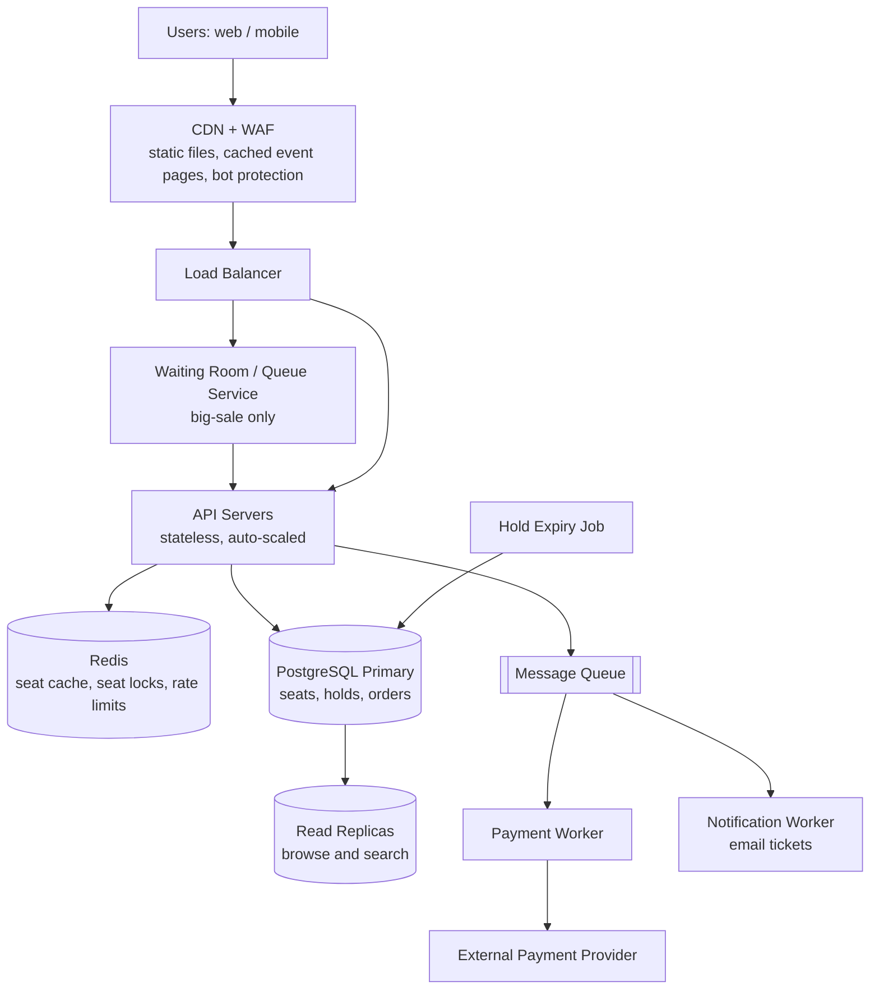

# TicketHub: System Design

TicketHub sells tickets for concerts and events. This document follows the six-part framework: requirements, estimates, API, data model, architecture, trade-offs.

---

## 1. Requirements

### Functional
1. Users can register, log in and manage their account.
2. Users can browse and search events (by name, city, date, category).
3. Users can view an event's seat map with the live status of each seat (available / held / sold).
4. Users can **hold** one or more seats for a short time (e.g. 5 minutes) while they pay.
5. Users can pay for held seats and receive confirmed tickets.
6. Users can view their purchased tickets (with a QR code) and order history.
7. Organizers can create events and set prices and seat layouts (admin side, out of scope for the detailed API).

### Non-functional

| Quality | Requirement | Why it matters |
|---|---|---|
| **Speed** | Browsing pages: p95 < 300 ms. Seat map: p95 < 500 ms. Hold request: p95 < 1 s, even during a big sale. | Users abandon slow sites, and during a sale a slow response means a lost seat. |
| **Correctness** | A seat is **never** sold to two people. A user is never charged without getting a ticket, and never gets a ticket without paying. Money and tickets must agree. | Double-selling is the one failure that cannot be fixed with an apology; it means two angry customers and refunds. |
| **Fairness** | During a high-demand sale, access is roughly first-come, first-served. Bots and one person opening 50 tabs must not get a large advantage. Limit tickets per user per event (e.g. 6). | If the sale feels rigged, users leave the platform. |
| **Availability** | Browsing stays up (99.9%) even if payments are degraded. The site must degrade gracefully, not crash, under the big sale. | Peaks are exactly when the most users are watching. |
| **Durability** | Once an order is confirmed, it is never lost. | Tickets are proof of purchase. |
| **Scalability** | Handle roughly 100x normal traffic for short bursts. | See estimates below. |
| **Security** | Passwords hashed, payment data handled by a payment provider (we never store card numbers), HTTPS everywhere. | Legal and trust reasons. |

Consistency choice: browsing may be **eventually consistent** (a seat map a few seconds stale is acceptable), but holding and buying must be **strongly consistent**.

---

## 2. Estimates

### Normal day
- Page views: 50,000 visitors x 10 pages = **500,000 page views/day**.
- Average rate: 500,000 / 86,400 s = about **6 requests/s**.
- Traffic is not flat. Assuming the busiest hour has about 10x the average: about **60 requests/s peak**.
- Sales: 5,000 tickets/day = about **0.06 tickets/s** average; even with a 10x evening peak, under **1 sale/s**.
- Storage: 5,000 tickets/day x 365 = about 1.8 million tickets/year. At roughly 1 KB per ticket/order-item row that is under 2 GB/year, small for a single database.

A normal day is easy: one small database and a couple of web servers would cope.

### "Big sale" (popular concert goes on sale)
- 200,000 people try to buy 20,000 seats in the first 10 minutes (600 s).
- Arrivals: 200,000 / 600 = about **333 new users/s** on average, but most arrive in the first minute or so.
- Each user does roughly: load event page, load seat map (and refresh it a few times), attempt 3-5 seat holds as seats get taken. Assume about 15 requests per user over the 10 minutes, giving 3 million requests.
  - Average: 3,000,000 / 600 = about **5,000 requests/s**.
  - Opening spike (first 30-60 seconds, about 3x the average): about **15,000 requests/s**.
- Hold attempts: 200,000 users x 4 attempts = 800,000 / 600 = about **1,300 hold attempts/s** average, perhaps **4,000/s** at the spike, all fighting over the same 20,000 rows.
- Successful sales: 20,000 / 600 = about **33 orders/s** average. Because unpaid holds expire and are re-sold, the payment system sees a bit more than that.
- Demand vs supply: 200,000 people for 20,000 seats, so **10 people per seat, and 90% will go home empty-handed.** This is why fairness and clear "sold out" messaging matter.

### Comparison

| Measure | Normal day | Big sale (10 min) | Ratio |
|---|---|---|---|
| Requests/s (peak) | ~60 | ~5,000 avg, ~15,000 spike | **~80-250x** |
| Tickets sold | 5,000 per **day** | 20,000 in **10 minutes** | 4x a whole day's sales in 0.7% of the time |
| Writes on hot rows | spread over many events | all on **one event's 20,000 seats** | extreme contention |
| Users | 50,000 spread across the day | 200,000 within minutes | 4x users in 1/144 of the time |

The conclusion: the problem is not total volume but **burstiness and contention**. Everyone wants the same event and the same good seats at the same second. We must design for the peak, but scale it up only when needed.

---

## 3. API

REST over HTTPS, JSON bodies. Authentication via a bearer token (JWT) except for public browse endpoints.

| # | Endpoint | Purpose | Notes |
|---|---|---|---|
| 1 | `GET /events?city=&date=&category=&page=` | Browse/search events | Public, cacheable (CDN, 30-60 s). |
| 2 | `GET /events/{eventId}` | Event details | Public, cacheable. |
| 3 | `GET /events/{eventId}/seats` | Seat map with status per seat | Public; served from cache (1-2 s old); returns `available / held / sold`. |
| 4 | `POST /events/{eventId}/holds` | Hold seats | Auth required. Body: `{"seatIds": [101, 102]}`. Returns `201` with `holdId`, `expiresAt`; or `409 Conflict` listing seats that are no longer available. |
| 5 | `DELETE /holds/{holdId}` | Release a hold early | Auth required. |
| 6 | `POST /orders` | Pay for a hold | Auth required. Header `Idempotency-Key: <uuid>`. Body: `{"holdId": "...", "paymentToken": "..."}`. Returns `201` with the order, or `410 Gone` if the hold expired, or `402` if payment failed. |
| 7 | `GET /me/tickets` | View my tickets | Auth required. Returns tickets with QR codes. |
| 8 | `GET /orders/{orderId}` | Order status | Auth required; owner only. |
| 9 | `POST /auth/register`, `POST /auth/login` | Accounts | Public. |

Example hold:

```http
POST /events/42/holds
Authorization: Bearer <token>
Content-Type: application/json

{ "seatIds": [101, 102] }
```
```http
201 Created
{ "holdId": "h_9f3a", "seatIds": [101,102], "expiresAt": "2026-11-07T20:05:00Z" }
```
```http
409 Conflict
{ "error": "SEAT_UNAVAILABLE", "unavailableSeatIds": [102] }
```

Design notes:
- Holding and paying are **separate steps** so the user has time to enter payment details without keeping a database transaction open.
- `POST /orders` is **idempotent**: if the client retries after a timeout, the same `Idempotency-Key` returns the same order instead of charging twice.
- A hold is all-or-nothing: either all requested seats are held, or none.

---

## 4. Data Model

Relational database (PostgreSQL), because correctness and transactions matter most.

```
users 1 ──< orders 1 ──< order_items >── 1 seats >── 1 events
   │                                        │
   └──< holds 1 ──< (seats via holds.hold_id on seats)
```

### Tables

**users**
| Column | Type | Notes |
|---|---|---|
| id | BIGINT PK | |
| email | TEXT | **UNIQUE**, NOT NULL |
| password_hash | TEXT | NOT NULL |
| name | TEXT | |
| created_at | TIMESTAMPTZ | |

**events**
| Column | Type | Notes |
|---|---|---|
| id | BIGINT PK | |
| name | TEXT | NOT NULL |
| venue | TEXT | |
| city | TEXT | indexed |
| starts_at | TIMESTAMPTZ | indexed |
| sale_starts_at | TIMESTAMPTZ | when tickets go on sale |
| max_tickets_per_user | INT | default 6 |

**seats** (one row per physical seat per event; the heart of the system)
| Column | Type | Notes |
|---|---|---|
| id | BIGINT PK | |
| event_id | BIGINT FK -> events.id | indexed |
| section, row_label, seat_number | TEXT/INT | **UNIQUE (event_id, section, row_label, seat_number)** |
| price_cents | INT | CHECK (price_cents >= 0) |
| status | TEXT | CHECK (status IN ('available','held','sold')) |
| hold_id | BIGINT NULL FK -> holds.id | set while held |
| hold_expires_at | TIMESTAMPTZ NULL | |
| version | INT | optional optimistic-lock counter |

**holds**
| Column | Type | Notes |
|---|---|---|
| id | BIGINT PK | |
| user_id | BIGINT FK -> users.id | |
| event_id | BIGINT FK -> events.id | |
| expires_at | TIMESTAMPTZ | now + 5 min |
| status | TEXT | 'active', 'converted', 'expired', 'released' |

**orders**
| Column | Type | Notes |
|---|---|---|
| id | BIGINT PK | |
| user_id | BIGINT FK -> users.id | |
| hold_id | BIGINT FK -> holds.id | **UNIQUE** (one order per hold) |
| idempotency_key | TEXT | **UNIQUE** per user |
| total_cents | INT | |
| status | TEXT | 'pending', 'paid', 'failed', 'refunded' |
| payment_ref | TEXT | provider's transaction id |
| created_at | TIMESTAMPTZ | |

**order_items** (the ticket itself)
| Column | Type | Notes |
|---|---|---|
| id | BIGINT PK | |
| order_id | BIGINT FK -> orders.id | |
| seat_id | BIGINT FK -> seats.id | **UNIQUE**, a seat can appear on at most one ticket, ever |
| price_cents | INT | price at time of sale |
| qr_code | TEXT | UNIQUE |

### Relationships
- A **user** has many **holds** and many **orders** (1:N).
- An **event** has many **seats** (1:N).
- A **hold** covers many **seats** (1:N via `seats.hold_id`) and may become one **order** (1:1).
- An **order** has many **order_items**; each **order_item** points to exactly one **seat** (1:1, enforced by the UNIQUE constraint).

---

## 5. How Double-Booking Is Prevented

The goal: **two people can never end up owning the same seat**, even if they click within the same millisecond. We use several layers, and the last one is a hard guarantee that does not depend on application code being bug-free.

### Layer 1: Atomic conditional update inside a transaction (the hold)

Holding seats is a single SQL statement inside a transaction:

```sql
BEGIN;

UPDATE seats
SET status = 'held',
    hold_id = :new_hold_id,
    hold_expires_at = now() + interval '5 minutes'
WHERE event_id = :event_id
  AND id = ANY(:seat_ids)
  AND (status = 'available'
       OR (status = 'held' AND hold_expires_at < now()));   -- expired holds can be taken

-- If the number of rows updated != number of seats requested -> ROLLBACK, return 409
COMMIT;
```

Why this works:
- The check ("is it available?") and the change ("make it held") happen in **one atomic statement**. There is no gap between "check" and "act" where another request can sneak in (this gap is the classic *check-then-act race condition*).
- When two transactions update the same row, PostgreSQL takes a **row lock**. The second one waits until the first commits, then re-evaluates the `WHERE` clause, sees `status = 'held'`, matches **zero rows**, and gets a 409. Exactly one wins.
- If the user asked for 2 seats and only 1 was updated, we **ROLLBACK**, so holds are all-or-nothing (atomicity).
- Locks are taken in a consistent order (sorted `seat_ids`) to avoid **deadlocks** when two users request overlapping seat sets.
- READ COMMITTED isolation is enough here because correctness comes from the conditional update plus row locks; we do not rely on a prior SELECT.

### Layer 2: Fast reservation in Redis (to absorb the big sale)

During a big sale, 4,000 hold attempts/s would hammer the same rows. To protect the database, a hold first tries `SET seat:{eventId}:{seatId} {userId} NX EX 300` in Redis. `NX` means "only set if it does not exist", which is atomic in Redis. Losers are rejected immediately (409) without touching the database. Winners then perform the SQL in Layer 1. Redis is only a **filter**; if Redis loses data or disagrees, the database still has the final say.

### Layer 3: Re-check at payment time (the order)

`POST /orders` runs a transaction:

```sql
BEGIN;
-- Lock the seats of this hold and verify they are still ours and not expired
SELECT id FROM seats
WHERE hold_id = :hold_id AND status = 'held' AND hold_expires_at > now()
FOR UPDATE;
-- if count != expected -> ROLLBACK, return 410 Gone (hold expired)

INSERT INTO orders (...);                -- UNIQUE(hold_id), UNIQUE(user_id, idempotency_key)
INSERT INTO order_items (...);           -- UNIQUE(seat_id)
UPDATE seats SET status = 'sold' WHERE hold_id = :hold_id;
UPDATE holds SET status = 'converted' WHERE id = :hold_id;
COMMIT;
```

All the changes either happen together or not at all (atomicity), and `FOR UPDATE` stops the expiry job or another request from changing the seats mid-purchase.

### Layer 4: Database constraints as the final safety net

Even if every line of application code above had a bug, the schema refuses to double-sell:
- `order_items.seat_id` is **UNIQUE**: a second ticket for the same seat fails with a constraint violation, and its transaction rolls back.
- `orders.hold_id` is **UNIQUE** and `(user_id, idempotency_key)` is **UNIQUE**: a retried or double-clicked payment cannot create two orders.
- `seats.status` has a **CHECK** constraint so it can only hold valid values.
- Foreign keys prevent tickets pointing at non-existent seats or orders.

### Payment timing and edge cases
- We charge the card **after** locking the seats and **inside the flow with an idempotency key**: if the payment fails, we roll back the order and the seats return to `held` until expiry (or are released). If the payment succeeds but our database commit fails, a reconciliation job finds the payment with no order and refunds it, so users are never charged without a ticket.
- A background job runs every few seconds to release expired holds (`status = 'available'`). Because Layer 1 also treats expired holds as available, correctness does not depend on this job running on time.
- Per-user limit (e.g. 6 per event) is checked in the hold transaction by counting active holds and sold items for that user.

---

## 6. Architecture



Text version of the same flow:

```
Users -> CDN/WAF -> Load Balancer -> [Waiting Room] -> API Servers -> Redis
                                                              |-> PostgreSQL primary -> read replicas
                                                              |-> Message Queue -> Payment worker -> Payment provider
                                                                                 -> Notification worker
Hold Expiry Job -> PostgreSQL primary
```

### Components

| Component | What it does | Why it is there |
|---|---|---|
| **CDN + WAF** | Serves static assets and cached event pages/lists; blocks obvious bots and abusive IPs. | Removes the vast majority of read traffic before it reaches our servers; supports fairness. |
| **Load balancer** | Spreads requests across API servers; health checks. | No single server is a bottleneck or single point of failure. |
| **Waiting room (virtual queue)** | During a big sale, users get a random/FIFO queue position and are admitted to the buying flow at a rate the system can handle (e.g. a few thousand at a time). | Turns a 15,000 req/s spike into a steady, controlled flow; gives fairness and a calm user experience. |
| **API servers** | Stateless services implementing the API above. | Stateless means we can add servers quickly (auto-scaling) with no data to move. |
| **Redis** | Caches seat maps (1-2 s), holds short-lived seat locks (`SET NX EX`), counts rate limits. | Absorbs reads and the hold race so the database sees only winners. |
| **PostgreSQL primary** | Source of truth for seats, holds, orders, with transactions and constraints. | Strong consistency for the double-booking guarantee. |
| **Read replicas** | Serve search and event listings. | Keeps browsing load off the primary that handles writes. |
| **Message queue** | Decouples slow work from the request: payment processing, emails, PDF/QR generation. | Slow third-party calls cannot pile up threads in the API. |
| **Payment worker + provider** | Charges cards via an external provider, with idempotency keys. | We never store card data; retries are safe. |
| **Notification worker** | Sends confirmation emails with tickets. | Not on the critical path. |
| **Hold expiry job** | Periodically frees expired holds. | Seats return to the pool for the next buyer. |

### How it survives the big sale
1. **Pre-scale**: for scheduled big sales we know the time in advance, so we pre-warm extra API servers and Redis capacity instead of relying only on reactive auto-scaling.
2. **Cache the reads**: event pages sit in the CDN; the seat map is served from Redis and refreshed every 1-2 seconds, so 200,000 people watching the map do not become 200,000 database queries. Optionally the seat map is pushed as small diffs rather than refetched in full.
3. **Waiting room**: admits only as many users as the system can handle, so the database sees hundreds of hold attempts per second, not tens of thousands.
4. **Redis as bouncer**: losers of the seat race are rejected in Redis; only the roughly 20,000 winners (plus retries) reach PostgreSQL.
5. **Short transactions**: each DB transaction touches a few rows and holds locks for milliseconds, and payment happens *outside* any long transaction.
6. **Rate limits and per-user caps**: limit requests per user/IP, tickets per user, and one active hold per user, so bots and multi-tab users do not dominate.
7. **Graceful degradation**: if payments slow down, the queue absorbs the work and holds simply last a little longer; browsing stays up thanks to the CDN. A clear "sold out" page is served from cache when seats run out, instantly relieving the system.
8. **Sharding option**: all contention is within one event, so if one database ever becomes too small we can partition `seats` by `event_id`.

Failure handling: Redis down means holds fall back to Layer 1 directly against PostgreSQL (slower, still correct). API server dies means the load balancer routes elsewhere and holds are unaffected because state lives in the database. Primary DB fails means promote a standby; committed orders are safe because of synchronous replication to at least one standby.

---

## 7. Trade-offs

1. **Strong consistency (SQL) vs. raw scalability (NoSQL).**
   We chose PostgreSQL with transactions and constraints for seats and orders, which gives a hard no-double-booking guarantee but has a single write primary that is harder to scale than a NoSQL store. We reduce the cost with Redis in front, a waiting room, and the option to shard by event. We accept this because selling a seat twice is worse than being a little slower.

2. **Hold-then-pay (pessimistic reservation) vs. pay-then-confirm (optimistic).**
   Holding seats for 5 minutes gives users a fair, predictable checkout, since nobody pays and then learns the seat is gone. The cost is that abandoned holds **lock up inventory**: during a sale, seats can look "held" while real buyers are blocked, and bots can hoard seats. Mitigations: short hold time, one hold per user, per-user caps, and re-releasing expired holds immediately. Pay-then-confirm avoids hoarding but causes failed purchases after the user has already been charged, which is a worse experience.

3. **Waiting room vs. open access.**
   A queue protects the system and improves fairness, but adds complexity and makes the first seconds feel slower for some users. Without it we would need far more servers just for 10 minutes a year. We chose the queue and some over-provisioning.

4. **Cached seat map vs. real-time accuracy.**
   A 1-2 second stale seat map means some users click seats that were just taken and get a 409. That is acceptable because the hold endpoint is the authority; in return we cut read load by orders of magnitude.

5. **Redis lock layer vs. database-only locking.**
   The extra layer adds a component that can disagree with the database, but it is only a performance filter and the database constraints remain the source of truth, so a Redis failure costs speed, never correctness.
